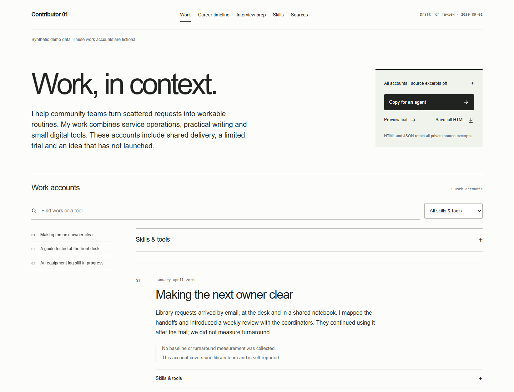

# Career Context AI

**Keep the context behind your work.**

Turn selected notes, documents and conversations into one readable file: what you did, why it mattered, who else contributed and what happened next. Give that file to an agent for a resume, interview or career question without rebuilding your story each time.



Use work documents only with an approved model and sources you are allowed to share.

## Try the sheet

[Download the project](https://github.com/Mikeishiring/career-context-ai/archive/refs/heads/main.zip), extract it and open **[CAREER-CONTEXT.html](CAREER-CONTEXT.html)** in a browser. The example is fictional and works offline.

Open a work account, follow its sources, then try **Preview text**. **Copy for an agent** carries the same account, including shared credit and limits. GitHub displays HTML as source; use the downloaded file.

For a notebook with a custom navigation menu, quarterly work, visual evidence and interview follow-ups, open **[CAREER-NOTEBOOK.html](CAREER-NOTEBOOK.html)**. This edition uses the same fictional source packet, with an explicit quarterly companion. [Notebook guide](skills/career-context-sheet/references/notebook.md).

## Make it yours

Give your agent the complete [career-context-sheet](skills/career-context-sheet/SKILL.md) folder and selected material. It includes source discovery, role-specific evidence guidance, a local SQLite archive, and HTML renderers for context, resumes and interview preparation.

> Use this skill to build my career context. Reuse what you know about my work and goals, discover the sources available here, and guide me through any missing access. Collect relevant evidence and visual examples within scope. Adapt the organization to my work, preserve shared credit and uncertainty, and create a private local database with one HTML entry point. Use my reference material when I ask for a resume or interview preparation.

Start with one useful account. The agent should pursue consequential questions and challenge its first draft; you should not need to keep asking it to go deeper.

[Get started with Claude, Codex or another agent](docs/GETTING-STARTED.md).

Ask the agent to [prepare an interview](skills/career-context-sheet/references/interview-prep.md). It selects the evidence and drafts an introduction, answers, story chapters and timelines from your context. You review, practise and resolve genuine gaps.

## What you keep

- **Your work in context:** personal decisions, shared work, outcomes and unfinished questions.
- **Inspectable evidence:** selected excerpts remain distinct from summaries and interpretation.
- **One portable HTML file:** readable accounts, plain agent text, structured context and selected images travel together.
- **A local SQLite archive:** searchable accounts and sources, selected image bytes, collection coverage and recoverable revisions.
- **Role-appropriate drafts:** [resumes](skills/career-context-sheet/references/resume.md) with print/PDF and text export, plus interview preparation grounded in the same context.

The scripts use Python 3.11+ with no packages or network calls. The agent you choose does the research and writing. Live source connectors are supplied by your host; installing this project does not connect accounts. Collection covers selected accessible sources, not every platform or all career history. The database is private and unencrypted.

## For developers

The [product contract](docs/PRODUCT.md) defines the release criteria. The core product is the skill and portable sheet. Build the standalone skill bundle without the research harness:

```sh
python tools/build_skill.py ../career-context-sheet.zip
```

The optional local research server adds scoped export access, turning-point review and saved-draft recovery. A bounded supervisor can resume interrupted workers; see the [research flow](docs/RESEARCH-TO-SHEET.md). Experiments remain available in the repository so their results and failures can be inspected.

| Need | Guide |
|---|---|
| Create, update or share a sheet | [Getting started](docs/GETTING-STARTED.md) |
| Select local exports and use the research server | [Local context](docs/LOCAL-CONTEXT.md) |
| Understand storage and sharing | [Privacy](docs/PRIVACY.md) |
| Inspect research methods and results | [Research guide](ai-search-mvp/README.md) · [Event retention](docs/EVENT-RETENTION.md) · [Batch extraction](docs/BATCH-EXTRACTION.md) · [Deep-review result](docs/DEEP-RESEARCH-RESULT.md) |
| Build, test or contribute | [Contributing](CONTRIBUTING.md) |

The research server currently uses selected snapshots. Live connectors, automatic refresh and reliable semantic review remain under development.

[MIT licensed](LICENSE).

Copy all accounts or select one; private source excerpts are excluded from copied text unless selected. Attribution and limits remain. Full HTML and JSON always include all selected sources. Optional links lead to separately delivered local files.
