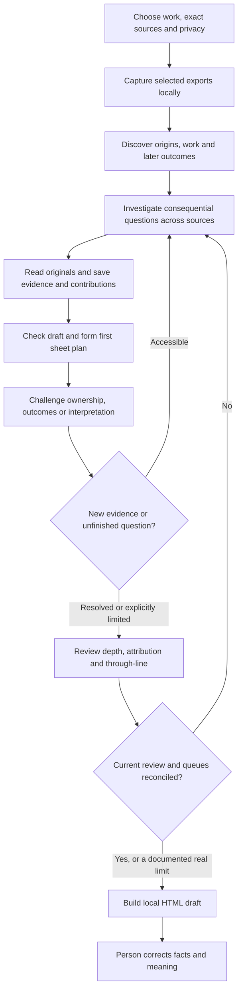

# The first draft is the midpoint

Career Context AI should investigate the context behind a person's work without repeated requests to go deeper. The integrated flow now has ten times its original source/request capacity and an enforced review after the first story plan. Extra calls alone do not establish depth.

## What was missing

The earlier gate checked discovery coverage, source spans, saved notes and whether each material record reached the draft. That allowed a subtle omission: a record could be cited while one person's contribution disappeared from the prose. The first fictional story omitted explicit credit for the original proposal, despite reading its source.

The new gate accounts for each saved material **actor/action**, including the exact claim that carries it or a specific reason to omit it. It also requires actual question-led searches before planning an account and a fresh challenge after its first plan. A recorded intention to investigate is insufficient.

## What a deep account must consider

| Lens | Question to investigate |
|---|---|
| Origins | What preceded the visible project, and who proposed it? |
| Stakes | What constraint, need or consequence made the work matter? |
| Personal decisions | What did this person choose, reject or change, and why? |
| Shared ownership | Who initiated, diagnosed, reviewed, built, approved and operated it? |
| Implementation | What was delivered, and what remained proposed or unfinished? |
| Setbacks | What failed, was misunderstood, or required correction? |
| Later outcomes | What happened after delivery, including use, support, deferral or abandonment? |
| Contrary evidence | What would make the emerging account misleading? |
| Personal meaning | What did the person say they learned or cared about? What needs their voice? |
| Trajectory | How does this episode connect to other work, and where does the apparent pattern break? |

Each lens keeps a finding, counterpoint, exact evidence, represented claims and a next action when unresolved. Statuses are supported, limited, needs person, out of scope or pending. An accessible pending question blocks completion while budget remains. Unknown meaning is retained as a question; it is not filled with inferred personality or a manufactured turning point.

## Where the effort goes

The integrated server allows **450 charged source calls and 1,600 total requests**, compared with the first demonstration's **45 and 80**. Source: `depth_protocol.py` and the historical `completion_server.py` defaults. The total request ceiling includes extraction, cached recovery and batched attribution review; those local operations do not consume the charged source allowance. The demo launcher allows up to **one hour per attempt**, up from twenty minutes. These bounds increase capacity; they do not promise a tenfold runtime or require spending the entire budget.

At least two different depth questions must be investigated before each account's first plan. Probes must cover each selected source group. After that plan, a fresh query must challenge contrary evidence, ownership or later outcomes for each account. The researcher should continue beyond those minimums whenever an accessible question could change the story.

Repeated queries use cached results; relabelling a cached search does not satisfy the post-draft challenge. Notes, cached recovery and reviews cost requests but no source calls. The researcher can spend additional effort interpreting existing originals and repairing the narrative without acquiring more data. Source and request budgets survive resume.

## What stays local

The selected-source policy, admitted captures, source receipts, exact excerpts, evidence notes, plans and depth reviews stay in the private workspace. `local-status` saves the current per-account findings and gaps in the checklist. The portable HTML contains the narrative, selected excerpts, questions and limits; it does not contain the entire working journal.

DM access still requires explicit permission and exact selected conversations. More effort never widens scope. Model access remains off until explicitly permitted. Once permitted, selected text is processed by the connected AI host under that host's data handling. Local persistence is not the same as local model inference.

## What the checks can establish

The server checks real search receipts, full-read spans, current notes and drafts, complete lens accounting, attribution references and unresolved work. Changing evidence, notes or the selected plan makes the review stale. A proposed cross-episode pattern needs claims from at least two accounts; one episode cannot pass as a career-wide pattern.

The researching agent still supplies the interpretations and omission reasons. The validator cannot determine whether a reason is thoughtful or a paraphrase is fair. It cannot recover material absent from the selected exports, independently verify privacy labels, or infer the person's unspoken motivations. Agent review never changes the sheet to person-reviewed.

The skill-only workflow carries these instructions but cannot enforce the server's gates. Live source connectors, automatic refresh and independent semantic review are separate unfinished capabilities. Older sealed journals remain reproducible as explicitly legacy runs; they are not retroactively presented as deep-reviewed.

[Set up local context](LOCAL-CONTEXT.md) · [Run the fictional trial](RESEARCH-TO-SHEET.md) · [Inspect the original result and its omission](RESEARCH-STORY-RESULT.md)
